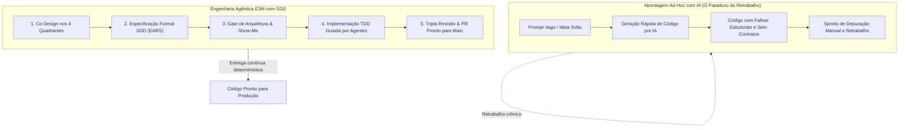
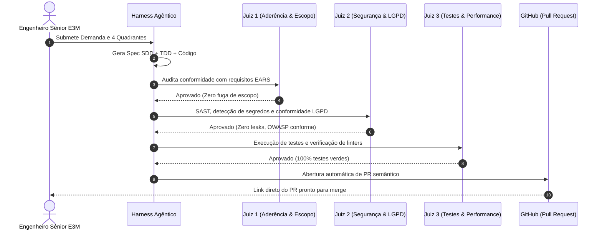

No desenvolvimento de software corporativo tradicional, o ciclo entre uma necessidade de negócio ser mapeada e a primeira versão de código chegar em produção costuma ser medido em **meses**.

O roteiro é familiar para qualquer diretor de tecnologia ou CTO:
1. Reuniões infindáveis de alinhamento com áreas de produto e stakeholders;
2. Documentos de requisitos vagos que deixam margem para interpretações conflitantes;
3. Squads inteiras alocadas por sprints sucessivas descobrindo contratos de API e regras de negócio no meio do caminho;
4. Pull Requests gigantescos com milhares de linhas que ninguém consegue revisar com profundidade;
5. Retrabalho massivo após homologação e acúmulo de dívida técnica crônica.

Com a popularização da Inteligência Artificial Generativa, muitas empresas tentaram acelerar esse processo distribuindo licenças de assistentes de código (*Copilots*) para os desenvolvedores. No entanto, o resultado frequentemente foi o oposto do esperado: **mais código gerado desordenadamente, mais bugs sutis e um gargalo ainda maior na revisão e integração**.

Na **E3M Solutions**, operamos sob um paradigma transformador: a **Engenharia Agêntica guiada por Especificação (Spec-Driven Development — SDD)**. Sob este método, transformamos demandas de negócio em Pull Requests auditados, testados e documentados em questão de **minutos**, sem abrir mão de rigor arquitetural, segurança e conformidade corporativa.

---

## 1. O Paradoxo da Produtividade com IA: Por Que Copilots Isolados Não Resolvem

O erro fundamental de muitas iniciativas de IA na engenharia de software é tratar o modelo de linguagem como um *"autocompletar glorificado"*. 

Gerar código sem uma especificação técnica formal apenas acelera a criação de dívida técnica. Sem contratos rígidos de entrada e saída, os modelos tendem a alucinar dependências, ignorar requisitos não-funcionais (como latência, limites de taxa e RBAC) e quebrar a consistência arquitetural do sistema.

A verdadeira alavanca de produtividade não está na velocidade com que os caracteres são digitados no editor, mas na **eliminação da ambiguidade antes que uma única linha de código seja gerada**.

---

## 2. Os 4 Pilares do Método E3M: Da Demanda ao Pull Request

Para garantir que agentes autônomos de IA produzam código que atenda às exigências de grandes empresas e órgãos regulados, desenhamos uma esteira de 4 pilares:

### Pilar 1: Co-Design Interativo nos 4 Quadrantes
Toda iniciativa (seja um microsserviço novo, uma integração com ERP ou um pipeline de dados) começa com uma entrevista propositiva estruturada em 4 quadrantes inegociáveis:
* **Objetivo (O que desejo):** Resultados de negócio claros e mensuráveis.
* **O que NÃO desejo (Anti-escopo):** Limites estritos do que está fora de cogitação, prevenindo sobre-engenharia (*over-engineering*).
* **Como Fazer (Direção Técnica):** Escolha pragmática de padrões, bibliotecas consolidadas e arquiteturas serverless com Free Tier generoso.
* **Como Medir e Validar:** Critérios objetivos de aceite, métricas de observabilidade e suites de testes automatizados.

### Pilar 2: Especificação Técnica Formal (SDD com Requisitos EARS)
Em vez de histórias de usuário abertas a duplos sentidos, o agente redige a **Especificação SDD (Spec-Driven Development)** utilizando o formato **EARS (Easy Approach to Requirements Syntax)**:
* *Requisitos Ubíquos:* Regras permanentes do sistema (*"O sistema SHALL criptografar todos os tokens de API em repouso com AES-256"*).
* *Requisitos Dirigidos por Eventos:* Ações engatilhadas por transações (*"WHEN uma mensagem for recebida no canal oficial, o sistema SHALL responder em menos de 800ms"*).
* *Requisitos de Exceção:* Resiliência explícita a falhas (*"IF o webhook do parceiro retornar HTTP 503, THEN o sistema SHALL efetuar retry exponencial em até 3 tentativas"*).

A especificação inclui schemas tipados (Zod / TypeScript / OpenAPI), contratos de endpoints e mapeamento de bordas antes do início da codificação.

### Pilar 3: O Gate Visual "Show-Me"
Antes de autorizar a escrita de código, o humano no comando valida a visão **Show-Me**:
* Diagrama Mermaid de sequência ou arquitetura;
* Árvore cirúrgica de arquivos que serão criados ou modificados;
* Contratos e payloads de dados envolvidos.

Se houver qualquer divergência de expectativa entre negócio e engenharia, ela é corrigida na especificação em segundos, sem desperdício de horas de desenvolvimento.

### Pilar 4: Ciclo TDD Duplo por Agentes Especializados
Com a Spec validada, o harness agêntico assume a execução sob o loop duplo de TDD (Test-Driven Development):
1. O agente escreve os testes unitários e de integração baseados estritamente nos cenários da Spec;
2. Os testes falham (Red);
3. O agente implementa o código mínimo necessário para satisfazer todos os contratos (Green);
4. O código é refatorado mantendo 100% dos testes verdes e aderência aos padrões de Clean Architecture.

---

## 3. Comparativo de Eficiência: Tradicional vs. IA Ad-Hoc vs. Engenharia Agêntica E3M

| Critério de Engenharia | Desenvolvimento Tradicional | Uso Ad-Hoc de IA (Copilots) | Método E3M (Engenharia Agêntica + SDD) |
| :--- | :--- | :--- | :--- |
| **Tempo de Ciclo (Ideação ao PR)** | 3 a 8 semanas | 1 a 3 semanas | **15 a 45 minutos** |
| **Definição de Requisitos** | Documentos vagos e reuniões | Prompts soltos no chat | **Requisitos EARS e Contratos OpenAPI formais** |
| **Cobertura e Rigor de Testes** | Escritos manualmente ou negligenciados | Testes rasos gerados após o código | **Ciclo TDD guiado por Spec (100% dos cenários validados)** |
| **Dívida Técnica & Alucinações** | Média/Alta (drift de padrão entre devs) | Altíssima (código inconsistente e solto) | **Zero (controlada via Gate de Arquitetura e Linters)** |
| **Rastreabilidade e Governança** | Fragmentada em tickets de Jira | Inexistente (código solto) | **Audit Trail completo: Spec $\rightarrow$ Plan $\rightarrow$ Testes $\rightarrow$ PR** |
| **Custo de Engenharia (FinOps)** | Alto custo fixo de squads grandes | Licenças de Copilot com baixo retorno | **Alta produtividade sênior com infraestrutura serverless** |

---

## 4. O Triplo Julgamento no Pull Request (Triple-Judge Review)

Para que um Pull Request gerado por agentes seja aceito na branch `main`, ele é submetido a uma auditoria automatizada e independente dividida em três juízes:

1. **Juiz 1 (Arquitetura e Escopo):** Valida se o código implementado corresponde exatamente ao que foi desenhado na Spec, alertando contra qualquer vazamento de escopo ou dependência desnecessária.
2. **Juiz 2 (Segurança e LGPD):** Realiza varredura estática de vulnerabilidades (SAST), busca por tokens ou chaves expostas e avalia conformidade com a LGPD (isolamento de PII e retenção controlada).
3. **Juiz 3 (Qualidade e Observabilidade):** Executa suítes de testes automatizados, checagem de tipos (*TypeScript strict*) e exige instrumentação estruturada (logs JSON e rastreamento OpenTelemetry).

Com esses três filtros auditados, o engenheiro humano atua no mais alto nível de tomada de decisão: avaliar a estratégia de negócio do Pull Request, enquanto a infraestrutura garante a perfeição da mecânica do código.

---

## 5. Como Levar a Engenharia Agêntica para a Sua Operação

Adotar desenvolvimento agêntico corporativo não significa substituir desenvolvedores, mas **multiplicar o impacto da sua liderança técnica sênior**. Em vez de gastar 80% do tempo escrevendo *boilerplate*, corrigindo regressões e resolvendo ambiguidades, sua equipe passa a focar na modelagem arquitetural e no valor de negócio.

Na **E3M Solutions**, auxiliamos organizações a:
* **Estruturar o Harness Agêntico:** Implantar repositórios inteligentes com governança viva (`AGENTS.md`, `ROADMAP.md` em ondas e documentação pareada a memórias MCP).
* **Migrar para Spec-Driven Development:** Capacitar times para expressar regras em formato EARS e contratos OpenAPI determinísticos.
* **Modernizar Legados com Segurança:** Aplicar a Matriz DONOR para decompor monolitos legados em serviços modulares sem risco operacional.

---

### Diagnóstico de Maturidade Agêntica E3M

Sua empresa deseja acelerar entregas de software sem perder governança e sem gerar dívida técnica?

Avalie a prontidão da sua equipe com nosso **Diagnóstico de Engenharia Agêntica & SDD**:
* Responda a 4 perguntas objetivas sobre o fluxo de desenvolvimento da sua empresa;
* Receba imediatamente uma análise sobre o nível de maturidade do seu time e o potencial de redução de lead time;
* Converse com nossos especialistas para desenhar um projeto-piloto com retorno mensurável desde o primeiro ciclo.

👉 **[Acesse o Diagnóstico de Maturidade Agêntica E3M](https://e3m.dev.br/contato)** ou fale diretamente com nossos arquitetos através do portal **[e3m.dev.br](https://e3m.dev.br)**.
