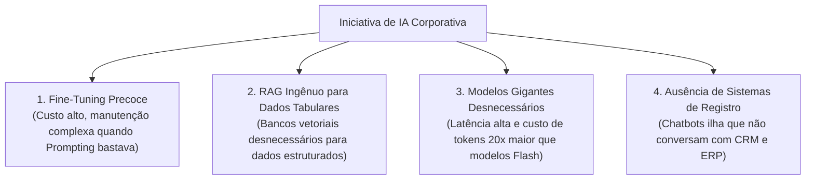
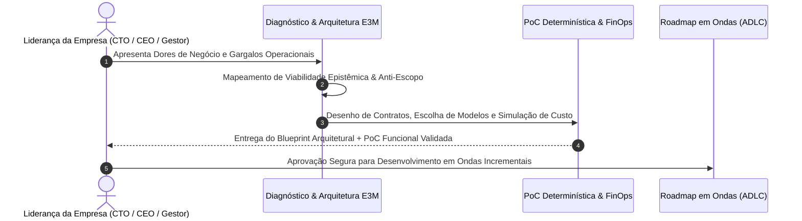

No cenário corporativo atual, a pressão sobre diretores de tecnologia, líderes de inovação e fundadores é unânime: **"Precisamos colocar Inteligência Artificial na nossa operação para ontem"**. 

Diante dessa urgência, muitas empresas saltam etapas cruciais. Contratam fábricas de software, alocam squads inteiras de desenvolvedores ou fecham pacotes com consultorias genéricas para construir protótipos e provas de conceito (PoCs) aceleradas.

Seis meses e centenas de milhares de reais depois, o resultado costuma ser decepcionante: um protótipo instável que alucina dados, consome orçamentos astronômicos de API em nuvem, não se integra aos sistemas centrais da empresa e, no final, **não move nenhuma métrica real de negócio**.

O erro fundamental não está na inteligência artificial em si, mas no modelo de execução: **tentar codificar uma solução antes de conduzir um diagnóstico arquitetural rigoroso**.

Na **E3M Solutions**, defendemos uma abordagem diametralmente oposta baseada em Engenharia de Software Pragmática: **o papel de um parceiro técnico sênior é dizer o que NÃO fazer, dimensionar custos e riscos antes de uma única linha de código e comprovar o Retorno sobre o Investimento (RO.AI) desde o primeiro ciclo**.

---

## 1. As 4 Armadilhas Tecnológicas Mais Caras em Projetos de IA

Ao avaliar dezenas de iniciativas de IA corporativa, nossa equipe de arquitetura mapeou quatro armadilhas recorrentes que drenam orçamentos:

### 1. A Armadilha do Fine-Tuning Precoce
Muitas lideranças acreditam que, para a IA "entender o linguajar da empresa", é necessário treinar ou ajustar finamente (*Fine-Tuning*) um modelo fundacional. 
* **A Realidade:** Ajuste fino é caro, exige pipelines massivos de curadoria de dados e congela o conhecimento no tempo. 
* **A Abordagem Pragmática:** Em mais de 90% dos casos de uso de negócio, **engenharia de contexto estruturada (Few-Shot Prompting) somada a chamadas de ferramentas (Function Calling)** resolve o problema com 1/50 do custo e atualização em tempo real.

### 2. A Armadilha do RAG Ingênuo para Dados Estruturados
Outro equívoco comum é tentar indexar planilhas financeiras ou tabelas relacionais do ERP em bancos vetoriais (Embeddings / Vector DBs). Modelos vetoriais buscam similaridade semântica, não exatidão matemática.
* **A Realidade:** Consultar saldos, faturas ou estoques via embeddings gera respostas imprecisas ou alucinações perigosas.
* **A Abordagem Pragmática:** Integrar a IA via APIs REST/gRPC tipadas e autenticadas, onde o modelo consome dados canônicos diretamente do banco de dados relacional.

### 3. A Armadilha dos Modelos "Ultra-Pesados" (Over-Engineering de LLMs)
Utilizar os modelos maiores e mais caros do mercado para tarefas simples de classificação, triagem ou extração de entidades é uma das maiores causas de estouro de orçamento FinOps.
* **A Abordagem Pragmática:** Modelos modernos leves (como Gemini 2.5/3.8 Flash ou Claude Haiku) executam tarefas de classificação e extração em menos de 500 milissegundos com uma fração mínima do custo por milhão de tokens.

### 4. A Síndrome do Assistente Isolado
Construir um robô que apenas conversa sobre políticas institucionais em PDF, incapaz de abrir um ticket, registrar um lead ou consultar um pedido no ERP. Como detalhamos em nossa esteira editorial, um assistente desconectado dos sistemas centrais é apenas um FAQ glorificado.

---

## 2. A Matriz de Decisão Arquitetural da E3M

Antes de definir qualquer stack técnica, o diagnóstico da E3M submete a demanda a uma matriz técnica de adequação:

| Estratégia Técnica | Quando É a Escolha Ideal? | Complexidade & Custo | Risco Operacional |
| :--- | :--- | :--- | :--- |
| **Fluxos Determinísticos & Automação** | Processos rígidos, regras de negócio 100% lógicas e sem ambiguidade | Baixíssimo (zero custo de IA) | Zero |
| **API Prompting + Function Calling** | Atendimento receptivo, triagem, geração de conteúdo e consulta a sistemas | Baixo / Médio (Serverless pay-per-use) | Controlado via Guardrails |
| **RAG Estruturado Corporativo** | Bases documentais massivas, normativos técnicos, contratos e bases jurídicas | Médio (Embeddings + Vector Index) | Baixo com citações de fonte |
| **Fine-Tuning de Domínio Estrito** | Estilos de redação altamente especializados ou modelos locais embarcados (Edge) | Muito Alto (Curadoria contínua e GPU) | Alto (drift de modelo e custo) |

---

## 3. O Diagnóstico Técnico da E3M em 4 Fases

Nossa consultoria de diagnóstico e arquitetura atua em ciclos curtos de 2 a 3 semanas, entregando um **Blueprint Arquitetural Completo** antes que a organização faça investimentos pesados:

### Fase 1: Viabilidade Epistêmica & Classificação Rigorosa
Separamos o que é **Fato Comprovado** do que é **Inferência** ou **Incerteza**. Analisamos se o problema realmente exige inteligência artificial ou se fluxos de automação de software tradicional entregam um resultado superior com custo zero de tokens.

### Fase 2: Mapeamento de Dados, Integrações e LGPD
Avaliamos a prontidão dos dados corporativos: onde residem, qual a qualidade dos schemas e como estruturar a camada de permissões (RBAC) e *Zero Data Retention* para garantir conformidade legal com a LGPD e ANPD.

### Fase 3: Dimensionamento FinOps e Latência
Calculamos a projeção de custo por transação, dimensionamos o consumo de tokens sob picos de atendimento e estabelecemos arquiteturas serverless (Google Cloud Functions v2, Firebase) que operam sem custos fixos ociosos.

### Fase 4: O Blueprint Executivo e a PoC Funcional
Entregamos uma especificação técnica formal (SDD), contratos de dados em OpenAPI/Zod, diagrama de blocos e um protótipo funcional mínimo demonstrando a integração em funcionamento.

---

## 4. O Conceito "RO.AI": Retorno Real Sobre Inteligência Artificial

Toda iniciativa de IA desenvolvida ou arquitetada pela E3M é pautada por uma métrica inegociável: **o Retorno sobre IA (RO.AI)**.

Uma provocação pragmática para qualquer tomador de decisão:
> *"Qual retorno tangível a inteligência artificial trouxe para a sua empresa no último trimestre? Se a resposta não envolver horas recuperadas do time, redução de custos operacionais, aumento na conversão de vendas ou blindagem contra riscos, sua estratégia técnica precisa ser recalculada."*

A E3M não vende "projetos de IA" genéricos. Desenhamos arquiteturas que destravam gargalos reais do negócio, integrando inovação de fronteira com os princípios mais sólidos da engenharia de software tradicional.

---

## 5. Como Iniciar o Seu Diagnóstico Técnico

Se a sua empresa planeja iniciar um projeto de IA, modernizar sistemas legados ou destravar uma iniciativa interna que empacou em fase de protótipo:

1. **Sessão Técnica Consultiva (30 Minutos Sem Custo):** Converse diretamente com nossos arquitetos seniores para avaliar a viabilidade técnica e arquitetural da sua demanda;
2. **Diagnósticos Interativos:** Explore nossos utilitários rápidos de maturidade agêntica, automação e FinOps para identificar onde estão as maiores oportunidades de otimização no seu cenário.

Entre em contato conosco e garanta que o investimento em tecnologia da sua empresa gere resultados concretos, seguros e mensuráveis.

---

*Artigo publicado originalmente pela equipe de engenharia da [E3M Solutions](https://e3m.dev.br). Compartilhe com líderes de tecnologia, diretores e tomadores de decisão da sua organização.*
