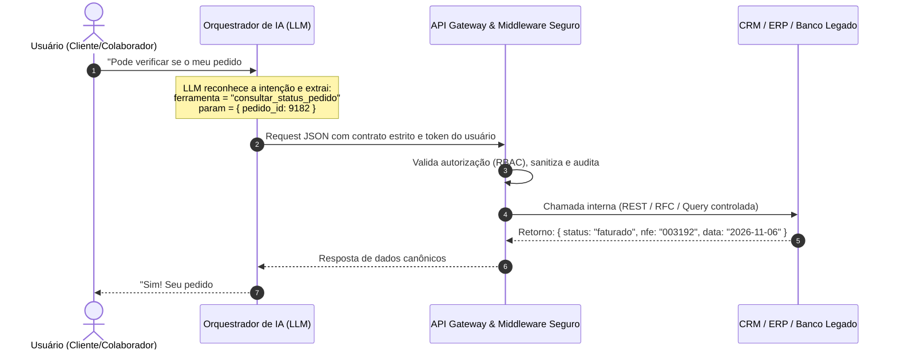

Grande parte dos projetos corporativos de Inteligência Artificial lançados recentemente sofre do mesmo sintoma silencioso: a **"síndrome do assistente ilha"**. 

A empresa investe semanas configurando um Large Language Model (LLM) avançado, alimenta sua base de conhecimento com dezenas de manuais em PDF e publica o chatbot em seus canais de atendimento ou comunicação interna. Nos testes iniciais, o robô responde com maestria sobre a história da empresa, regras institucionais e perguntas frequentes. 

No entanto, no primeiro dia em que um cliente real ou colaborador faz uma pergunta transacional concreta — *"Qual é o status do meu pedido #4089?"*, *"Pode atualizar o endereço da minha fatura?"* ou *"Qual o saldo em aberto desse cliente no ERP?"* —, a experiência desaba. O assistente é forçado a admitir: *"Sou apenas uma inteligência artificial e não tenho acesso a esses dados. Por favor, entre em contato com nosso time pelo telefone..."*.

Um assistente que não conversa com o ecossistema de software da empresa é apenas um FAQ glorificado. O verdadeiro retorno sobre investimento (ROI) de sistemas inteligentes só se materializa quando o assistente se torna um **operador ativo do negócio**, integrado aos sistemas de registro (*Systems of Record*).

Neste artigo, detalhamos como arquitetar integrações corporativas robustas entre assistentes de IA e **CRMs, ERPs e bancos de dados legados**, blindando a operação contra alucinações, vazamentos de dados e quebras de integridade.

---

## 1. Os Três Grandes Mundos de Dados Corporativos

Para que uma IA entregue valor transacional, ela precisa transitar com segurança por três camadas distintas da organização:

### A. O Mundo Comercial & Relacionamento (CRMs)
* **Sistemas típicos:** Salesforce, HubSpot, Pipedrive, Zoho CRM ou ferramentas proprietárias.
* **O que o assistente precisa fazer:**
  * Consultar o estágio atual de uma oportunidade ou histórico de interações antes de responder a um contato importante;
  * Qualificar automaticamente um lead e criar ou atualizar o card no funil de vendas sem trabalho braçal do vendedor;
  * Registrar resumos executivos de reuniões e transcrições diretamente na linha do tempo do cliente.

### B. O Mundo Operacional & Financeiro (ERPs)
* **Sistemas típicos:** SAP, TOTVS (Protheus/Datasul), Omie, ContaAzul, Senior.
* **O que o assistente precisa fazer:**
  * Consultar faturas, boletos e posição de crédito de clientes;
  * Rastrear status de expedição, notas fiscais (NF-e) e ordens de compra;
  * Validar estoque e disponibilidade de insumos em tempo real.
* **Regra de ouro:** **Zero tolerância à alucinação.** Se um LLM errar o valor de um boleto ou inventar uma nota fiscal, o impacto financeiro e jurídico é imediato.

### C. O Mundo Legado & On-Premises (Bancos Relacionais & APIs SOAP)
* **Sistemas típicos:** Bancos SQL Server, Oracle, PostgreSQL internos, sistemas legados em AS/400 ou web services SOAP XML legados.
* **O que o assistente precisa fazer:**
  * Recuperar históricos cadastrais de décadas ou regras de negócio consolidadas que ainda não foram migradas para a nuvem;
  * Operar como uma interface em linguagem natural para consultas que antes exigiam comandos SQL complexos criados por analistas de suporte.

---

## 2. Como a IA Realmente Conversa com Sistemas: De RAG a Function Calling

Muitas equipes tentam integrar dados corporativos simplesmente "injetando texto" via RAG (Retrieval-Augmented Generation) tradicional. Embora o RAG seja excelente para documentos não-estruturados (políticas, contratos e atas), ele é inadequado para dados transacionais voláteis.

A arquitetura profissional para integração transacional baseia-se em **Function Calling / Tool Calling (Chamada de Ferramentas Estruturadas)**:

Nesse modelo, **o modelo de linguagem não calcula faturas nem inventa regras de banco**. Ele atua como um tradutor inteligente de linguagem natural para chamadas de função tipadas e auditadas, e depois traduz os dados brutos de volta para uma resposta humanizada e empática.

---

## 3. Os 4 Mandamentos de Segurança e Governança

Ao abrir os sistemas centrais da empresa para interação via IA, a equipe de engenharia e segurança deve seguir princípios inegociáveis:

### 1. Proibição Absoluta de "Text-to-SQL" Direto em Produção
Jamais permita que um LLM gere queries SQL arbitrárias executadas diretamente contra a base de dados de produção. Essa prática abre brechas catastróficas para:
* **SQL Injection indireto:** Injeção de instruções maliciosas por prompts de usuários;
* **Consultas desastrosas:** Uma query sem cláusula `LIMIT` ou sem índices adequados pode travar o banco do ERP em horário de pico;
* **Risco de mutações:** Uma interpretação equivocada gerando comandos `UPDATE` ou `DELETE` sem restrições.

> **Padrão E3M:** O LLM só interage com **APIs previamente desenhadas, validadas com schemas estritos (Zod/OpenAPI) e parâmetros sanitizados**. O modelo decide *qual* endpoint chamar, mas nunca escreve a instrução de banco.

### 2. Controle de Acesso Baseado em Papéis (RBAC & Identidade)
O assistente precisa saber **quem está perguntando** antes de executar qualquer ferramenta:
* Um cliente externo autenticado via WhatsApp só pode consultar dados associados ao seu próprio CNPJ/CPF;
* Um consultor de vendas pode ver clientes da sua carteira, mas não dados de margem operacional do ERP;
* O contexto de autorização é propagado no *header* da requisição para o Gateway corporativo, garantindo que a decisão de acesso nunca fique a cargo da discricionariedade do LLM.

### 3. Human-in-the-Loop para Ações de Escrita Críticas
Operações de leitura (*queries*, status, extratos) podem ser 100% automatizadas. Contudo, ações de mutação sensíveis — como cancelar um pedido, conceder um desconto comercial ou alterar dados bancários — devem exigir confirmação explícita em dois passos ou aprovação de um supervisor humano antes da efetivação no ERP.

### 4. Trilha de Auditoria e Observabilidade (OpenTelemetry)
Toda interação transacional deve gerar um evento de auditoria imutável contendo:
* Identificador único da sessão e do ator (`actor_id`);
* Ferramenta acionada e argumentos sanitizados (sem vazamento de dados sensíveis sob a LGPD);
* Latência da resposta do sistema integrado;
* `trace_id` distribuído para rastreabilidade de ponta a ponta.

---

## 4. Matriz Executiva: O Que Integrar Primeiro?

Para evitar projetos intermináveis, a estratégia mais eficiente é priorizar integrações por **relação valor vs. risco**:

| Tipo de Integração | Exemplos Práticos | Risco Técnico | Ganho de Negócio | Prioridade Recomendada |
| :--- | :--- | :--- | :--- | :--- |
| **Consultas Receptivas de Alta Frequência** | Status de pedidos, 2ª via de boleto, rastreamento de entregas | Muito Baixo | Muito Alto (reduz ~60% dos chamados) | **Onda 1 (Imediata)** |
| **Enriquecimento Comercial** | Registro de leads no CRM, qualificação de briefing | Baixo | Alto (poupa horas do time de vendas) | **Onda 1 (Imediata)** |
| **Atualizações Cadastrais Simples** | Troca de e-mail de faturamento, telefone de contato | Médio | Médio | **Onda 2 (Após estabilização)** |
| **Mutações Financeiras & Contratuais** | Cancelamentos, emissão de crédito, renegociação | Alto | Alto | **Onda 3 (Com Human-in-the-loop)** |

---

## 5. Como a E3M Solutions Desenha Essa Arquitetura

Na **E3M Solutions**, desenvolvemos integrações de IA seguindo uma abordagem de **Engenharia de Software Pragmática e Serverless**:

1. **Camada de Adaptação Desacoplada (BFF - Backend-for-Frontend):** Criamos micro-serviços ou Cloud Functions v2 que isolam o ERP e o banco legado da IA. Se o seu ERP for atualizado ou trocado, o assistente permanece inalterado.
2. **Resiliência e Circuit Breaking:** Se o banco legado entrar em manutenção ou apresentar lentidão, o orquestrador informa o usuário com elegância e cria uma tarefa assíncrona, sem travar a conversa.
3. **Padrão OpenTelemetry & LGPD:** Logs mascarados, tokens efêmeros e conformidade técnica rigorosa com a legislação brasileira de proteção de dados.

Se a sua empresa já possui assistentes em teste ou deseja planejar a arquitetura certa para conectar sua IA ao coração operacional do seu negócio, entre em contato conosco.

---

*Artigo publicado originalmente pela equipe de engenharia da [E3M Solutions](https://e3m.dev.br). Compartilhe com líderes de tecnologia e tomadores de decisão da sua organização.*
