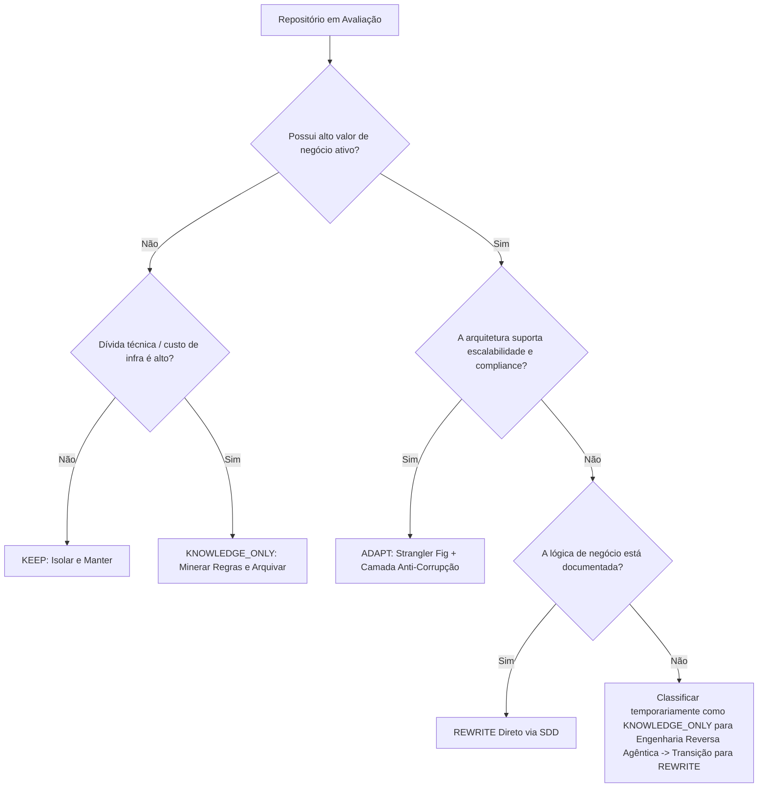

O dilema clássico da liderança de engenharia ao lidar com sistemas legados envolve dois extremos igualmente perigosos: a paralisia operacional pelo medo de quebrar regras de negócio não documentadas ou a aposta de alto risco em um *Big Bang Rewrite* — uma reescrita total que frequentemente estoura orçamentos, prolonga prazos e falha em replicar nuances operacionais acumuladas ao longo de anos.

A modernização eficiente não trata o código legado como um entulho a ser sumariamente descartado, mas sim como uma **base doadora de inteligência de negócio**. Para mitigar riscos e maximizar o retorno sobre o capital investido em engenharia, a transição precisa ser não-destrutiva, pragmática e orientada a dados.

Apresentamos a metodologia de classificação de repositórios em quatro quadrantes de transição: **KEEP**, **ADAPT**, **REWRITE** e **KNOWLEDGE_ONLY**. Trata-se de um framework analítico para arquitetos e VPs de Engenharia desmembrarem monólitos ou ecossistemas fragmentados utilizando princípios de *Specification-Driven Development* (SDD) e Engenharia Agêntica.

---

## A Armadilha do Big Bang e a Premissa Não-Destrutiva

Pesquisas de mercado indicam consistentemente que mais de 70% das iniciativas de reescrita completa falham ou não entregam o ROI projetado. O motivo fundamental não reside na incapacidade técnica da equipe, mas na **perda de contexto institucional**. Regras de validação obscuras, exceções tributárias, fluxos de contingência e tratamentos de casos de borda residem exclusivamente no código-fonte, sem documentação formal atualizada.

Uma abordagem não-destrutiva baseia-se em um axioma simples: **o sistema em produção continua faturando enquanto sua lógica é progressivamente extraída, validada e transferida.**

Ao invés de interromper entregas para "arrumar a casa", o ciclo de desenvolvimento orientado a agentes (ADLC) permite mapear a base existente por meio de ferramentas estáticas e LLMs especializadas, extraindo especificações executáveis sem alterar o comportamento do ambiente produtivo.

---

## Os Quatro Quadrantes da Matriz de Transição

A classificação de cada microsserviço, módulo ou monólito legado deve seguir uma avaliação multidimensional de dois eixos principais: **Valor de Negócio/Diferenciação Competitiva** vs. **Custo de Manutenção/Acoplamento Técnico**.

```
                  Alto |
                       |    ADAPT           |    REWRITE
                       |  (Modernização     |  (Reescrita Nativa
                       |   Incremental)     |   Guiada por SDD)
  Diferenciação        |--------------------+--------------------
  Competitiva          |    KEEP            |  KNOWLEDGE_ONLY
                       |  (Manutenção       |  (Base Doadora de
                       |   Cirúrgica)       |   Especificação)
                  Baixo|
                       +-----------------------------------------
                                Baixo                Alto
                                Complexidade & Dívida Técnica
```

### 1. KEEP (Manutenção Cirúrgica)
* **Perfil:** Código estável, com baixa taxa de mudança (*churn rate*), baixa complexidade ciclomática e sem gargalos de escala ou custos proibitivos de infraestrutura.
* **Estratégia:** Isolar o componente. Nenhuma refatoração estética é permitida. Alterações são restritas a correções críticas de segurança ou *patches* de conformidade.
* **Governança:** Bloqueio de novas funcionalidades no repositório; novas demandas acoplam-se externamente via Webhooks ou Barramentos de Eventos.

### 2. ADAPT (Isolamento e Evolução Periférica)
* **Perfil:** Componentes que sustentam diferenciais de negócio ativos, mas sofrem com acoplamento moderado. A estrutura interna ainda suporta extensões sem risco sistêmico inaceitável.
* **Estratégia:** Aplicação do padrão *Strangler Fig* (Figueira Estranguladora) combinado com uma Camada Anti-Corrupção (ACL).
* **Ação Técnica:** O repositório é encapsulado por gateways de API modernos. Novas lógicas residem em serviços desacoplados (frequentemente *serverless*), enquanto chamadas legadas são progressivamente drenadas.

### 3. REWRITE (Reescrita Limpa Orientada a Especificação - SDD)
* **Perfil:** Sistemas críticos para a estratégia corporativa, mas que atingiram falência técnica estrutural: incapacidade de escalar horizontalmente, violações graves de conformidade (LGPD, PCI-DSS), custos operacionais de nuvem desproporcionais ou tecnologias descontinuadas.
* **Estratégia:** Reconstrução total do componente, mas estritamente **guiada por especificação prévia**, e não por suposições.
* **Ação Técnica:** Proibição de reescrita manual no estilo "olhar o código velho e tentar codificar o novo". O código legado é submetido a *pipelines* de extração que produzem contratos de dados formais (OpenAPI, JSON Schema, modelos comportamentais), que servem como o *input* exclusivo para a nova implementação em arquitetura nativa em nuvem.

### 4. KNOWLEDGE_ONLY (Base Doadora)
* **Perfil:** Repositórios "zumbis", monólitos de tecnologia obsoleta (e.g., Delphi, VB6, PHP monolítico sem frameworks) ou bases altamente complexas cujo custo de refatoração ou migração supera qualquer ganho funcional direto.
* **Estratégia:** Congelamento total da execução (*read-only*). O repositório existe única e exclusivamente como **fonte de verdade de regras de negócio** a serem mineradas.
* **Ação Técnica:** Leitura de AST (Abstract Syntax Tree) e orquestração de agentes de IA para traduzir lógicas algorítmicas, validações de domínio e casos de borda em testes funcionais (Gherkin/Cucumber) e especificações executáveis para o novo sistema. O código legado é descontinuado assim que a paridade de especificação é atingida.

---

## Matriz Comparativa de Decisão Arquitetural

| Critério | KEEP | ADAPT | REWRITE | KNOWLEDGE_ONLY |
| :--- | :--- | :--- | :--- | :--- |
| **Taxa de Churn (Alterações)** | < 5% ao ano | Média / Frequente | Alta demanda de evolução | Nenhuma (Freeze) |
| **Complexidade Ciclomática** | Baixa a Moderada | Moderada | Alta / Intratável | Extrema / Legada |
| **Débito de Observabilidade** | Tolerável | Mitigado via Proxy/Gateway | Zero Tolerância (OpenTelemetry) | Irrelevante (Não rodará) |
| **Vetor de Risco** | Baixo | Médio (Dependências) | Alto no corte / Baixo no longo prazo | Zero em produção |
| **Destino no Roadmap** | Congelado | Encapsulado | Substituído por Micro-app/Serverless | Arquivado pós-extração |

---

## Framework de Classificação: Algoritmo de Triage

Antes de autorizar uma única alocação de equipe em iniciativas de modernização, submeta o inventário de repositórios ao seguinte fluxo lógico determinístico:



### Critérios Quantitativos para Avaliação
1. **Volatilidade de Commits vs. Incidentes (Bug Density):** Módulos que demandam commits constantes e apresentam alta correlação com incidentes em produção são candidatos imediatos a `REWRITE` ou isolamento em `KNOWLEDGE_ONLY`.
2. **Tempo Médio de Onboarding (TTO):** Se um novo engenheiro sênior leva mais de 6 semanas para entregar uma alteração segura no repositório, o custo de mantê-lo ativo supera o custo de engenharia de uma nova especificação.
3. **Custo de Infraestrutura Unitário (FinOps):** Sistemas com modelos de cobrança por licença de banco de dados legado ou que exigem instâncias de VM gigantescas subutilizadas devem ser expostos via matriz de custos para justificar a classificação `REWRITE`.

---

## O Papel da Engenharia Agêntica e SDD na Extração de Regras

A maior falha dos processos tradicionais de modernização é o esforço humano despendido em leitura linha a linha de código desordenado. No contexto da **Engenharia Agêntica**, repositórios classificados como `KNOWLEDGE_ONLY` tornam-se insumos estruturados para modelos de linguagem especializados.

Em vez de desenvolvedores passarem meses mapeando código, agentes de IA executam três etapas fundamentais sob supervisão humana:

1. **Extração de AST e Dependências:** Identificação do grafo de execução e isolamento de fluxos de entrada e saída.
2. **Geração de Especificações Formais:** Transformação de algoritmos legados em especificações formais de domínio (DDD) e contratos estruturados (ex: OpenAPI v3 / AsyncAPI).
3. **Síntese de Testes de Paridade:** Criação automatizada de suítes de testes de regressão baseadas no comportamento histórico do código-fonte, garantindo que o novo sistema (desenvolvido sob o paradigma `REWRITE`) respeite os mesmos limites operacionais exigidos pelo negócio.

Esse modelo de **Desenvolvimento Orientado a Especificações (SDD)** elimina a ambiguidade. A equipe de engenharia não constrói um sistema baseado em suposições; constrói com base em contratos rigorosamente auditados e validados contra o legado.

---

## Governança, FinOps e Conformidade

Classificar repositórios com assertividade é também um exercício de gestão financeira e compliance:

* **FinOps:** Evita-se o "duplo custo infinito", no qual a empresa financia o custo operacional do legado e o custo de desenvolvimento da nova versão simultaneamente por anos. Ao aplicar `ADAPT` ou `KNOWLEDGE_ONLY`, define-se uma data fixa para o desligamento definitivo dos recursos do legado.
* **LGPD e Segurança:** Repositórios `KEEP` e `ADAPT` devem receber auditorias perimetrais estritas. Sistemas legados com dependências sem patches de segurança devem ser imediatamente removidos da internet pública, operando exclusivamente em sub-redes privadas através de túneis e proxies reversos com autenticação moderna (mTLS, Zero Trust).

---

## Conclusão: Previsibilidade no Lugar de Apostas

A modernização de software corporativo não precisa ser um jogo de azar de múltiplos trimestres. Tratar o código legado com respeito técnico significa reconhecer que ele carrega o DNA dos processos que viabilizaram a operação da empresa até o momento presente.

Ao estruturar seu portfólio de software sob as diretrizes de **KEEP, ADAPT, REWRITE e KNOWLEDGE_ONLY**, as lideranças de engenharia substituem a incerteza de refatorações destrutivas por um pipeline governado, focado em ROI, sem interrupções operacionais e preparado para alavancar metodologias ágeis de nova geração como SDD e Engenharia Agêntica.

---

> 👉 Descubra em 4 minutos como transformar sistemas legados em bases doadoras sem riscos de paralisação: [Link do Diagnóstico no Portal E3M]
